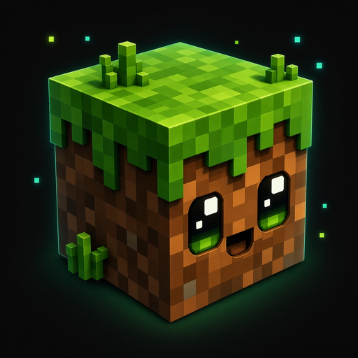

  

# Creative Quality Of Life

<small>por [alanjmrt94](https://github.com/alanjmrt94) · <a href="README.md"> Read in English</a></small>

Un kit práctico de comodidades de supervivencia para el día a día en Minecraft — **Forge**, **Fabric** y **NeoForge**.

**Este es mi tercer mod de Minecraft.**  
**Versión actual:** `1.20.1-0.7.0-beta.1` (**beta**) · Minecraft **1.20.1** · Cliente y servidor dedicado  

> Notas de versión: [changelog.txt](changelog.txt) (**siempre en inglés**) · notas anteriores aún listadas: `1.20.1-0.5.2` / `1.20.1-0.4.1`  
> Listing en tiendas: **Creative Quality Of Life** (`creative-qol`). La matriz cubre **1.20.1**, **1.21.1** y **26.1 / 26.2**.

---

## ¿Qué es?

**Creative Quality Of Life** es un kit de supervivencia práctica: no inventa un universo nuevo, sino que llena huecos del día a día — cocinar, guardar comida, tomar agua, dormir, iluminar y organizar el inventario — con reglas que se sienten naturales y se pueden apagar una por una.

En el centro está el **agua y los calderos**: teñís el agua y la usás en lana, camas, concreto o cuero; embotellás agua fresca o salada; destilás con un alambique; cocinás con fuego abajo; guardás peces; hacés helado con nieve; o limpiás tinte con una esponja. El agua sucia, el barro y las papas sucias también entran en esa misma lógica.

Alrededor de la comida hay una cadena completa: **la comida cocida se echa a perder** si no la cuidás; la **heladera**, la **heladera reforzada** y el **freezer** (incluso en combinación side-by-side) ralentizan o pausan ese proceso. Molés con **manivela + hopper** café, cacao, harina, jugo de naranja… Preparás **café** (arbusto, tazas, cafetera en brewing stand, con leche), **chocolate caliente** y **frascos** para servir varias porciones.

También podés **pintar lagos y océanos** con el Bidón de tinta de agua (el agua vanilla sigue siendo vanilla; solo cambia el color del paisaje). Las antorchas se mojan con el clima; dormir cerca de una fogata cura un poco más; los animales pueden dormir; fijás slots de la hotbar; anotá día, coords y bioma en un bloc sin perder el libro al morir.

Todo pasa por un **menú in-game** (Mods → Config / Mod Menu, o la Tableta QoL en creativo), con tooltip en cada opción. No es un kitchen-sink infinito: son comodidades concretas, activables, pensadas para que la supervivencia se sienta más viva y menos tediosa.

Los apartados **Ver detalles** abajo son opcionales (números, claves de config y reglas finas).

## Funciones (v0.7.0-beta)

### Tinte de agua de paisaje

- **Bidón de tinta de agua** — Bidón que pinta lagos y océanos con un overlay de color persistente (el agua sigue siendo vanilla).
  

  
Ver detalles

  **Crafteo:** lingotes de hierro + cristal + cubo vacío.  
  **Carga:** primero agua (cubo vanilla/sucio, botella, caldero, o clic en océano/río), después **un solo** color de tinte — rosa, lima, verde, cyan, púrpura, magenta o rojo — hasta **64** cargas (sin mezclar colores).  
  **Cargar tinte:** en el bloque colocado, con ambas manos (agua + tinte), o clic derecho con el tinte sobre el ítem en el inventario. A **64** se **sella** (no más tinte; no se vacía con Shift).  
  **Pintar:** clic derecho sobre agua con el bidón listo en la mano, o mano vacía sobre un bidón colocado listo. **Shift + mano vacía** quita una mancha cercana.  
  **Radio:** disco circular, lineal **2** (1 tinte) → **16** (64 tintes); vertical ±8. Persiste en datos del mundo (máx. **256** manchas/dimensión). Se rompe a mano (~1 s).  
  **Datos del ítem:** el bidón cargado guarda el estado del block entity en el stack. En **1.21.1+** ese componente debe incluir el `id` del BE (si falta, el sync creativo puede patear con `Missing id for entity`).  
  Config: `water_landscape_dye`.

  

### Sueño y descanso

- **Curar al despertar** — Al salir de una cama recuperás corazones.
  

  
Ver detalles

  Por defecto **1 corazón / 2 HP**; `0` lo apaga.

  

- **Bonus fogata** — Fogata encendida cerca suma corazones extra al despertar.
  

  
Ver detalles

  Default **+1 corazón** (**2 HP** sin fogata → **4 HP** con). Config: `campfire_sleep_bonus_hearts`.

  

- **Fogata y lluvia** — La fogata lit puede apagarse con lluvia o tormenta; hogares y chimeneas ayudan.
  

  
Ver detalles

  Chance base ya **−25%** (~**18,8%** lluvia / ~**60%** tormenta si está expuesta). **≥2 caras abiertas** (N/S/E/O/abajo) → ×**1,25**. **≤1 cara abierta** (hogar) → ×**0,5**. Hogar + **trapdoor cerrado** (justo encima, o hasta **16** con columna continua de chimenea) → **inmune**. Techo con **2 aires** entre fogata y techo → **0%** lluvia / ~**7,5%** tormenta. Incluye fogata de almas. Config: `campfire_rain_extinguish`.

  

### Antorchas

- **Antorchas húmedas** — El agua y el clima pueden apagarlas; se secan y pueden reencenderse solas o con flint and steel.
  

  
Ver detalles

  **Agua** en el bloque → **húmeda** (100%). Al exterior: **viento 10%** / **nieve 20%** / **nieve+lluvia 50%** → **apagada** (bioma frío: **20%** → húmeda). Solo lluvia no apaga. Secado ~**2 min** (más rápido cerca de fogata lit, radio 12); reencendido ~**2 min** (o flint and steel). Arena/grava encima → drop **apagada**. Ítems en agua/lluvia se humedecen. Config: `wet_torches`, `torch_dry_ticks`.

  

### Supervivencia / movimiento

- **Hambre por movimiento** — Saltar o correr gasta un poco más de hambre.
  

  
Ver detalles

  **+5%** al saltar o correr; **+10%** si hacés ambos a la vez. Config: `movement_hunger`.

  

### Calderos y agua

- **Caldero tintable** — Teñís el agua y usás el color en lana, camas, concreto y cuero.
  

  
Ver detalles

  Intensidad **1–3** (tinta negra incluida). Teñís lana, camas, concreto/polvo y **todo el cuero** (casco, pechera, pantalones, botas). En **1.21.1 / 26.1 / 26.2** el mismo camino tiñe también la **armadura de caballo de cuero** y la **armadura de lobo** vainilla (`#minecraft:dyeable` / `#minecraft:cauldron_can_remove_dye`). La armadura de lobo es **vainilla** (Java ≥1.20.5); **no existe en 1.20.1** (backport planeado fuera de QoL). El concreto vacía agua (intensidad 1 dura menos). Niveles 1–3 visibles. Un **cubo de agua** sube a nivel 3 y **diluye** la intensidad de a poco (no borra el color de golpe).

  

- **Botellas de agua coloreada** — Embotellás el agua teñida, la volcás de nuevo o las colocás en grupo.
  

  
Ver detalles

  Ítem `colored_water_bottle` (aspecto de poción). Beber: −½ corazón y 20% efecto random. Con glow, **brilla**. **Shift+clic** coloca hasta **32** botellas por bloque (pociones/splash/lingering vainilla, miel, XP, ominous bottle en 1.21+, y botellas QoL). Stack de inventario **32** para esas. Config `features.placed_bottles_3d` (default on): modelos 3D de decoración; off = sprites planos. La ominous bottle en 3D es oscura y tiene los puntos rojos del ítem. En **1.21.1**, un **name tag** sobre una botella colocada abre la pantalla de nombre; el texto blanco se ve bajo la mira al apuntarla.

  

- **Agua sucia** — Sacás el tinte en un cubo, lo vaciás o lo embotellás.
  

  
Ver detalles

  Cubo vacío + caldero teñido → cubo sucio (sin glint). Vaciar → cubo vacío / charco turbio. Botella sucia: veneno 2s, −hambre, 45% efecto random; compostador ~50%. Ver [Acciones especiales](#acciones-especiales).

  

- **Tinta luminosa (glow)** — El agua brilla un poco sin perder el color.
  

  
Ver detalles

  Luz vanilla monocroma + partículas del color. Glow aclara sin opacar el tinte (nivel 3 sigue intenso). Camas/lana/cuero/botellas con glow muestran glint (mixins).

  

- **Lluvia más rápida** — Los calderos se llenan más rápido con lluvia y tormenta.

- **Agua dulce / salada** — Embotellar en océano o en río/caldero no es lo mismo.
  

  
Ver detalles

  Océano = salada (náuseas). Río/caldero = dulce (bebible). Tooltips y tinte distintos.

  

- **Destilación simple** — Caldero con agua sobre fuego: sacás sal o agua dulce a mano.
  

  
Ver detalles

  Mano vacía → sal; sneak + botella → agua dulce.

  

- **Destilador** — Alambique con combustible: agua salada → dulce + sal (también sin botellas si hay calderos vecinos).
  

  
Ver detalles

  GUI: combustible, salada arriba, 3 botellas vacías → dulce + sal, refrigerante (nieve/hielo) a la derecha. Overlays de progreso (heater, líquido, tubos); label de inventario sin tapar botellas. En el mundo BER muestra ítems + tint de líquido (1.20.1–26.x). Receta: cobre + vidrio + hierro + botella. Sneak → manual en pantalla; al craftear el destilador también llega un **libro escrito** guía (pestaña Functional creativa también). Combustibles `#qolminecraft:distiller_fuels` (antorcha ≈½ carbón, blaze ≈3, palo ×2, lava ×3 horno). Lava deja **cubo de piedra fundida** (vaciar: piedra o mena rara). Antorcha/blaze también en horno/alto horno. Adyacente: océano/caldero salado → caldero dulce + sal (con fuel).

  

- **Sal y sazonado** — Condimentás comida con sal o azúcar; craft de bloque de sal.
  

  
Ver detalles

  NBT `qol_seasoning=salt|sugar` + tags. Sal +25% hambre; azúcar cura + Speed. Overlay/glint. Patata/pan sazonados legacy siguen. Bloque de sal = 9 sal.

  

- **Esponja en caldero teñido** — Saca tinte/glow sin vaciar el agua.

- **Caldero de lava** — Da luz y quema a quien esté adentro.
  

  
Ver detalles

  Luz default **15** (configurable). Daño on/off por config.

  

- **Caldero de nieve / helados** — Congela, se llena con nieve y sirve para hacer helado.
  

  
Ver detalles

  Congela según nivel (config). **Bloque de nieve** = lleno; **bolas** suman hasta 3 niveles. Un caldero lleno da **6** cucuruchos (2 porciones por nivel visual). El cubo de nieve en polvo suena a nieve (colocar/romper), no al chapoteo del cubo de líquido. Helado: leche + azúcar + tinte, leche azucarada + tinte, o leche + azúcar teñida → sabor; **cucurucho** (papel en cono: 3 arriba, azúcar al medio, 1 de punta) saca bocha. Cada pasada suma una bocha (hasta 3). Una sola ralentiza un poco. Dos o tres, u otro helado mientras sigue el frío, congelan unos segundos y escarchan la skin. En 1.20.1 y 1.21.1 la nieve del caldero toma un pastel suave del sabor. Una bocha se llama por la comida, no por el tinte: vainilla, naranja, frambuesa, crema del cielo, limón, pistacho, cereza, tiramisú, sésamo, arándano, uva, ananá, dulce de leche, menta, frutilla, chocolate. Leche + azúcar craftea leche azucarada (botella y jar). Azúcar + tinte craftea un azúcar de color por tinte. Tinte + leche no hace nada. Leche + dos de azúcar + vainilla en polvo, calentadas en un caldero vacío, hacen dulce de leche. La vainilla sale de una flor en tierra: se cosecha la chaucha y se muele.

  Huevera de 6 huecos (cuadrada en un bloque, angosta sobre una estantería) para cucuruchos, vasos y tazas de chocolate; las botellas no entran. Azúcar de color carga chispitas en un frasco (6, y 12 si repetís el color); ocho azúcares distintos en un balde hacen chispitas multicolor; el tinte suelto no entra. Clic derecho con el helado se las pasa a las bochas. Un recipiente que acepte el líquido del frasco lo llena con clic derecho y no abre pour/serve. Disco **Cones & Sprinkles** (Argentina y México: Conos y Chispas). Un freezer en marcha (nieve + redstone) zumba; con la puerta abierta más de 10 segundos salen humo y neblina de fogata. En **26.x** el caldero de nieve no toma el pastel.

  

- **Entrar al caldero** — Agua/teñido moja; algunos mobs se comportan distinto.
  

  
Ver detalles

  Config `cauldron_enter_effects` / `cauldron_water_wets`. Pollos quedan atrapados; loros flotan.

  

- **Señal de comparador** — El caldero reporta qué tiene adentro.
  

  
Ver detalles

  Vacío 0 · agua/teñida/nieve 1–3 · lava 3 · teñida + pez nivel+1 (máx. 4).

  

- **Peces en caldero** — Guardás tropical o globo; el globo envenena.
  

  
Ver detalles

  Burbujas en agua/teñido. **Shift + mano vacía** para sacar. Globo envenena al sacar o al estar dentro.

  

- **Cocinar en caldero** — Con calor debajo, cocinás comida cruda (o el pez guardado).
  

  
Ver detalles

  Calor: fuego, fogata lit, lava, magma… Gasta **1 nivel** de agua. Pez + mano vacía + calor → cocina el pez.

  

- **Patatas sucias y lodo** — A veces cosechás patata sucia; lavarla ensucia el agua y termina en lodo.
  

  
Ver detalles

  - Cosecha madura: chance default **5%** (`dirty_potato_chance`) de patata sucia.
  - Comer: menos saturación; chance de hambre breve.
  - Lavar en caldero con agua → patata limpia; el agua se pone marrón intensidad 1→2→3.
  - Al llegar a 3: **lodo húmedo** + caldero fangoso (embotellable). Lavados extra bajan el nivel.
  - Lodo húmedo / botella: compostador ~50%; horno → `minecraft:mud`; colocar → tierra (hueco) o charco de lodo (patina; no se va con lluvia).
  - Lodo vainilla extendido: patina + lento; parado te hundís ~⅓ (más con lluvia/tormenta).
  - Clima: lluvia puede pasar tierra→lodo; sol seca lodo→tierra (fuera de pantano/manglar). Config: `mud_world_effects`.

  

### Comida y bebidas

- **Comida que se pudre** — La comida cocida envejece si no la guardás bien.
  

  
Ver detalles

  Fresco → rancio → carne podrida (ticks configurables; se puede apagar). Tooltip con tiempo. Tag `#qolminecraft:never_spoils`. Sazonada se pudre más lento.

  

- **Heladera** — Baja la pudrición; puerta animada, interior hueco y un estante de plástico.
  

  
Ver detalles

  Mate/porosa (no combinable). Plancha aislante + nieve; spoilage ×0.25. Sonidos suaves tipo telgopor; GUI de inventario alineada al cofre vanilla; estantes con ítems. El interior no se ilumina de más.

  

- **Heladera reforzada** — Versión de hierro; se combina en vertical, Side by Side o con freezer.
  

  
Ver detalles

  Upgrade con hierro o craft desde cero. **2 vertical** = 54 slots; **2×2 Side by Side** con puertas francesas (un solo cuerpo, estantes de vidrio, slot de redstone para luz interior abierta — polvo o bloque; el polvo quema ~4× el carbón, el bloque no se gasta); **1 + freezer** (el combo funciona con el freezer arriba o abajo; los sonidos open/close siguen a la reforzada; neblina leve al abrir con nieve+redstone). Spoilage ×0.15. Sonidos de puerta/trampilla de hierro (un solo play al abrir/cerrar). GUI ancha con labels estilo Inventory e inventario del jugador centrado.

  

- **Freezer** — Congela spoilage con nieve; dos juntos forman tapa doble e interior nevado.
  

  
Ver detalles

  8 comida + 8 nieve (**16 bolas** por slot hermano). Acepta **polvo de redstone** (se gasta, ~6400 ticks) o un **bloque de redstone** (no se gasta) para la ráfaga (también sirve señal de vecinos). Freezer doble usa sonidos open/close de la reforzada. Al abrir un double freezer con nieve: partículas, overlay frío suave; daño de freeze solo tras **~10 s** con GUI abierta y nieve cargada. Revestimiento translúcido de nieve. GUIs (simple, doble, combo): títulos/labels estilo Inventory (gap sobre los slots), tinte celeste solo en Snow, ghost de redstone si el slot de fuel está vacío.

  

- **Naranjas y jugo** — Jugo más fuerte que la fruta; las hojas de acacia pueden dropear naranjas.
  

  
Ver detalles

  Quita veneno, resistencia breve, **−10%** daño de drowned. Prensa: naranja + botella en manivela+tolva. Se puede volcar a frasco. Visual opcional en árboles: `tree_fruit_visuals` (default off; naranjas también `orange_enabled`).

  

- **Jugo de manzana** — Botella (shapeless: manzana + botella de vidrio); se vuelca al frasco como el de naranja.
  

  
Ver detalles

  Quita veneno y regeneración breve. Placeable en 3D (Shift). Stackea como las otras botellas QoL. También lo produce el **exprimidor** con manzanas vanilla.

  

- **Exprimidor** — Prensa craftable para jugo de naranja/manzana en botellas, vasos o frascos.
  

  
Ver detalles

  Craft (shapeless): tolva + manivela + pistón + gancho de hilo → exprimidor. Colocá el exprimidor; encima una **tolva mirando abajo** con **manivela** acoplada; en la GUI del exprimidor poné botellas, vasos de papel o frascos vacíos; frutas en la tolva; mantené la manivela. Cada giro completo llena **1** recipiente y lo eyecta hacia el `FACING` (boquilla). El atajo del molino (naranja + botella en la tolva) sigue disponible. Config: `features.juicer_enabled`.

  

#### Manivela (molino)

- **Manivela + tolva** — Mantené clic para moler; los productos salen al cofre.
  

  
Ver detalles

  Colocá la manivela **arriba** o en un **costado** de la tolva. La boquilla solo aparece acoplada; se mantiene la primera conexión. Insumos sin moler se retienen; productos van al cofre. Al romper: vacía al cofre (**25%** de derrame). Progreso en action bar, sonido grindstone, pulso redstone 2–4 ticks. Recetas (toggles): café, cacao, trigo→harina, hueso→harina de hueso, cobble→gravel, naranja+botella. También `coffee_grind_turns`.

  

#### Café

- **Cultivo y bebidas de café** — Arbusto, vasos de papel, cafetera multiblock y compat blanda con Coffee Delight.
  

  
Ver detalles

  Arbusto sobre **arena**; bayas silvestres en biomas cálidos (si hay Coffee Delight, en Fabric no duplica worldgen). Bayas → granos → molido (también tinte marrón). **Pegamento de slime** + **vaso de papel**. Café en cuenco o vaso (−10% hambre, stamina, Speed largo). Café con leche (−20% hambre, +1 HP, quita veneno). Servir/beber desde frasco. Calentar 3 min en fuego/fogata/magma/lava. Azúcar potencia efectos. Soft-compat CD: tags, conversiones 1:1, asado, craft de café negro CD, cutting board.

  **Cafetera (multiblock):** **manivela + hopper arriba** de un brewing stand vanilla y **tanque de agua para café** debajo. El molino deposita molido en el stand (hasta 64); llena botellas/vasos con combustible (blaze/carbón/lava consumen; redstone no). Sin la estructura el stand sigue siendo de pociones. El craft shapeless queda como atajo. Config: `coffee_brew_ticks`.

  

#### Chocolate

- **Cadena de chocolate** — Del cacao al chocolate caliente y la chocolatada.
  

  
Ver detalles

  Cacao molido → manteca → barra. Chocolate caliente / chocolatada (~2 HP). Caliente: protección al frío 3 min. Mismas reglas de calor/azúcar que el café. No quita veneno.

  

#### Frascos

- **Frasco de vidrio** — Guardás varios líquidos y podés colocarlo para servir.
  

  
Ver detalles

  Hasta **4 porciones**. Llenar desde la otra mano (leche, miel, café, chocolate, agua, slime, jugo de naranja/manzana, cacao…). Frasco vacío o lleno se coloca en 3D (Shift+clic). Beber leche limpia efectos. Shift+uso vacía. Cuenco vacío sirve desde el frasco colocado. En **1.21.1**, un **name tag** sobre el frasco colocado (suelo o estantería) abre la pantalla de nombre, deja una etiqueta blanca sin letras y muestra el nombre en blanco bajo la mira al apuntarlo. Nombre vacío quita la etiqueta y no gasta el tag; un nombre gasta un tag (en creativo no). Al recoger el frasco el nombre se conserva. Config: `jars_enabled`.

  

### Animales

- **Animales duermen** — Algunos mobs duermen de día o de noche con partículas zzz.
  

  
Ver detalles

  Tags `#qolminecraft:diurnal_sleepers` / `nocturnal_sleepers`. Despiertan con daño, lluvia o jugador cerca. Config de chance y radio.

  

- **Domesticar un zorro** — Bayas dulces o brillantes pueden domesticar un zorro adulto.
  

  
Ver detalles

  Más o menos una de cada tres. Te sigue; clic derecho lo sienta o lo levanta. Pollo o conejo (crudo o cocido) hace que durante 5 días no elija pollos ni conejos. Config: `features.tame_foxes`.

  

- **Sentarse en escaleras** — Clic derecho en una escalera de abajo, sin un bloque en la mano.
  

  
Ver detalles

  Si hay una valla, alfombra o losa delante, mirás hacia esa mesa. Agacharte para levantarte. Con un bloque en la mano lo colocás. Config: `features.sit_on_stairs`.

  

- **Medallas y collares** — Tintá name tags en caldero, dales forma en yunque y renombrá mascotas, aldeanos, golems o (con consentimiento) otros jugadores.
  

  
Ver detalles

  Tintá un name tag en caldero → yunque + ingrediente de forma (manzana / libro / soul torch / esmeralda / pepita de oro / manzana dorada) → `name_medal`. Cinta opcional (`collar_ribbon`: cuero + 2 hilo, teñible) + medalla en yunque → `name_choker` (bicolor). Mascotas propias / aldeanos / golems: UI de nombre + medalla/choker colgante. Jugadores: solicitud Sí/No + cooldowns de 1 minuto (`features.player_collars`). El nombre del collar se ve sobre el nametag. Alimentar golems (`features.golem_feeding`): hierro / nieve / cobre (26.x). Config: `features.pet_name_medals`. En **1.20.1 / 1.21.1 / 26.1 / 26.2**.

  

### Inventario y construcción

- **Chimeneas** — Conductos huecos (5 materiales) que apilás sobre una fogata lit para que el humo salga por arriba.
  

  
Ver detalles

  Adoquín, ladrillos de piedra, ladrillos, deepslate adoquinado, adoquín musgoso. Autoconexión (abre la pared compartida); el humo solo sube en **vertical** (los codos horizontales son visuales). Craft: **2×2** del material → **4** chimeneas. Con hogar (≤1 cara abierta), un **trapdoor cerrado** justo encima—o hasta **16** de altura con columna continua de chimenea—evita que la lluvia apague la fogata. En **1.20.1 / 1.21.1 / 26.1 / 26.2**.

  

- **Cortinas** — Decoración de pared o techo (ondulada / lisa, 16 colores + sheer); el click cicla cerrada → semi → abierta.
  

  
Ver detalles

  Craft: 2 lana + palo (ondulada), 2 lana + hilo (lisa); sheer = lana blanca + cristal (+ hilo si lisa). Colocá en cara de pared (flush; leve separación en paneles/barras) o en el techo (cara inferior → barral + paño, hasta **3** de alto). Mismo color+estilo se combina en pares / 2×2 / columna de techo. Sin colisión. Config: `features.curtains`. En **1.20.1 / 1.21.1 / 26.1 / 26.2**.

  

- **Estanterías de pared y canasto** — Roble/acacia con soportes en los extremos que se unifican en fila; canasto de suelo para apilar fruta.
  

  
Ver detalles

  La estantería va en cara sturdy; el tablero queda al ras del bloque de arriba y las botellas se apoyan pegadas a lo largo de la pared. Encima podés colocar botellas/frascos/vajilla. Canasto: clic derecho con fruta del tag `#qolminecraft:basket_fruit` (manzana, manzanas de oro, rodaja de melón, glow berries, sweet berries, zanahoria, zanahoria de oro, pan, pan salado, papas y variantes, carne podrida, naranja, chorus); mano vacía saca; al romper dropea fruta + canasto. Config: `features.wall_shelves`, `features.fruit_basket`. Recetas: 3 losas + 2 palos (estante); palos + trigo (canasto). En **1.20.1 / 1.21.1 / 26.1 / 26.2** (en 26.x el décor 3D usa modelos FIXED de ítem por ahora; baked en 1.20.1/1.21.1).

  

- **Vajilla colocada** — Cuencos, vasos de papel y velas sobre superficies planas (suelo, tope sturdy, alfombra).
  

  
Ver detalles

  Shift+clic derecho coloca hasta **8** por bloque. Velas encendidas dan luz; el agua apaga. Mismo toggle 3D que las botellas (`features.placed_bottles_3d`). Si hay alfombra debajo, se guarda y vuelve al romper.

  

- **Costal de flechas** — Saco de tela en la espalda con hasta **4** tipos × **64** flechas; arco/ballesta toman de ahí.
  

  
Ver detalles

  Craft: cuero + hilo (`LSL` / `L L` / `LLL`). **Clic derecho** abre GUI de 4 slots. Tecla **V** cicla el slot activo (HUD al tensar). Config: `features.quiver_enabled`, `quiver.prefer_hotbar` (flechas sueltas del hotbar antes que el costal si está on). En la espalda se ve el saco 3D; las flechas sobresalen según la carga (1 / 2 / 4 / 8). En **1.20.1 / 1.21.1 / 26.1 / 26.2**.

  

- **Sábana fantasma y canasta de dulces** — Costume en offhand con lentitud/caída pluma/salto; la canasta sigue visible en la mano.
  

  
Ver detalles

  Sábana **solo en offhand**: Lentitud I + Slow Falling I + Jump Boost II; al saltar suena un “boo” a distancia. Con la sábana casi no se ven ni usan otros ítems — la **canasta de dulces** es la excepción. Capa a cuerpo completo en 3ª persona. En **1.20.1 / 1.21.1 / 26.1 / 26.2**. **Ghostface** (máscara, cuchillo, audio de suspenso) va en el mod aparte **Halloween Trick or Treat** (`halloweentot`), no acá.

  

- **Escrituras de horror** — Placas de sangre en pared; teclas **F7 / F8 / F9** ciclan el texto movie / window / chest.
  

  
Ver detalles

  Se colocan en pared con soporte. El idioma del **cliente** elige la textura (`*_en` / `*_es`), así cada jugador ve su idioma. En **1.20.1 / 1.21.1 / 26.1 / 26.2**.

  

- **Slots pineados** — Tecla **P**: fijás el hotbar para no tirarlo ni moverlo sin querer.
  

  
Ver detalles

  Tirar pide doble confirmación. Quick-move no mueve pineados. Icono en GUIs. Persisten en NBT del jugador.

  

- **Ghost block** — Vista previa del bloque antes de colocarlo.
  

  
Ver detalles

  Respeta orientación de slabs/stairs. Tecla **G**. **Apagado por defecto**.

  

### Escritura

- **Lápiz, lapicera y anotador** — Anotá día, nick, coords y bioma sin perder el libro al morir.
  

  
Ver detalles

  Lápiz: palos+flint. Lapicera: palos+tinta+`#qolminecraft:iron_nuggets` (+50% durabilidad; recarga con saco de tinta en la otra mano). Anotador: libro + lápiz/lapicera. **Clic derecho** abre el editor de libro (botones rápidos: día/hora, nick, XYZ, bioma). **Shift+clic derecho** inserta los cuatro de una. Gasta durabilidad al insertar. No se pierde al morir si la feature está on.

  

### Otros

- **Config in-game** — Menú con tooltips; también `config/qolminecraft-common.toml`.
  

  
Ver detalles

  Tableta creativa QoL. Analytics local/online (online con licencia). Samples de bloque/loot. Pestaña creativa del mod (`debug.creative_tab`, default on; reinicio al cambiar).

  

### Bedrock vs QoL (calderos)

Java + este mod **no** copian 1:1 los calderos de Bedrock. QoL tiene sus reglas; paridad Bedrock (pociones, tipar flechas, etc.) queda para más adelante **opt-in**.

Ver tabla de diferencias

| Tema | Bedrock (típico) | QoL (este mod) |
|------|------------------|----------------|
| Mezcla de tintes | Pueden mezclarse (estilo RGB) | Un color a la vez; otro tinte → intensidad 1 del nuevo color |
| “Fuerza” del color | Sobre todo teñido sí/no | Intensidad **1–3** + **glow** opcional |
| Botella / cubo al sacar | Suele ser agua normal / cubo vacío | **Botella coloreada**; cubo sucio conserva tinte |
| Añadir agua | A menudo destiñe de golpe | Diluye de a poco |
| Cuero / lana / camas / concreto | Enfoque en cuero | Set completo de cuero + lana/camas/concreto; **1.21.1/26.x** también horse + wolf armor vía tags dyeable |
| Pociones en el caldero | Llenar / tipar flechas / etc. | **No** — no es brewing stand |
| Tipar flechas | Sí en Bedrock | **No** en esta versión |
| Solo QoL | — | Destilador, dulce/salada, lodo, peces, cocinar, entrar, nieve, helados, lava |

No hay bloque “Legacy brewing” ni árbol completo de pociones en el caldero.

### Acciones especiales

Combinaciones de ítems (manos o inventario) que no son crafteos de mesa.

Ver tablas de acciones

#### Ítems en cada mano

Mano principal + secundaria (`F`). Clic derecho en el aire o en un bloque que no consuma el uso:

| Mano A | Mano B | Resultado |
|--------|--------|-----------|
| Botella de vidrio vacía | Cubo de agua sucia | 1 botella sucia; cubo vacío |
| Azúcar | Cuenco/vaso café / leche / chocolate | Endulza (potencia + Speed extra) |
| Cubo/jar de leche | Cuenco/vaso de café | Café con leche |
| Cubo/jar de leche | Chocolate caliente | Chocolatada |
| Frasco vacío | Leche / miel / bebida / agua / slime / jugo / cacao | Llena el frasco (+1 porción) |
| Frasco con leche (uso) | — | Beber leche (−1 porción) |
| Frasco con café (uso) | — | Beber café (−1 porción) |
| Frasco lleno (Shift+uso en bloque) | — | Coloca frasco colocado |
| Cuenco/vaso vacío | Frasco (mano o colocado) con café | Sirve café |
| Cuenco/vaso café o chocolate caliente | Frasco colocado con leche | Café con leche / chocolatada |
| Fuente de agua (cubo/botella) | Tinte permitido | Llena bidón en mano/colocado (agua y luego pigmento) |
| Bidón listo (uso sobre agua) | — | Pinta mancha circular; radio según cargas |
| Mano vacía sobre bidón colocado listo | — | Misma pintura |
| Shift + mano vacía en bidón / cerca de mancha | — | Vacía el bidón (si no está sellado) o quita mancha cercana |
| Botella / cuenco / vaso / vela (Shift+uso en superficie plana) | — | Coloca `placed_bottles` / `placed_vessel` (hasta el tope del bloque) |
| Fruta de canasto (uso en `fruit_basket`) | — | Agrega fruta; mano vacía saca la última |
| Name tag (uso en botella o frasco colocado, **1.21.1**) | — | Pantalla de nombre; texto blanco al apuntar; el frasco además muestra etiqueta blanca sin letras |
| Name tag teñido + ítem de forma (yunque) | — | `name_medal` de esa forma (1 XP) |
| `name_medal` + `collar_ribbon` (yunque, cualquier orden) | — | `name_choker` (colores medalla + cinta) |
| Medalla / choker / name tag (uso en mob o jugador elegible) | — | UI de nombre / solicitud de consentimiento; visual colgante si medalla/choker |
| Hierro / nieve / cobre (uso en golem herido) | — | Cura al golem (`features.golem_feeding`) |

#### Inventario (cursor)

| Acción | Resultado |
|--------|-----------|
| Botella vacía en el **cursor** + clic derecho sobre cubo sucio | Botella sucia; slot con cubo vacío |
| Cubo sucio en el **cursor** + clic derecho sobre botella(s) vacías | Llena 1 botella y vacía el cubo |
| Tinte permitido en el **cursor** + clic derecho sobre Bidón de tinta | +1 pigmento (mismo color; necesita agua; tope 64) |

## Cómo configurar

1. **In-game:** Opciones → Mods → **Creative Quality Of Life** → Config  
   - Fabric: **Mod Menu** si lo tenés  
   - O la **Tableta de config QoL** en creativo  
2. **Archivo:** `config/qolminecraft-common.toml`  
3. **Guardar y aplicar** en la UI para recargar al instante  

## Compatibilidad

| | |
|---|---|
| Minecraft | **1.20.1** (alpha en tiendas) · **1.21.1** sin publicar · **26.1 / 26.2** sin publicar |
| Loaders | **1.20.1 / 1.21.1:** Forge · Fabric · NeoForge · **26.x:** solo Fabric · NeoForge |
| Java | **17+** en 1.20.1 · **21+** en 1.21.1 · **25+** en 26.x |
| Lados | Cliente y/o servidor dedicado (la UI de config / pantallas solo cargan en cliente) |

Descargá el JAR de tu loader (`*-forge`, `*-fabric` o `*-neoforge`). No mezcles loaders.

## Contribuidores

Colaboradores del desarrollo (lista en construcción):

<!-- Formato: - Nombre ([@usuario](https://github.com/usuario)) — rol opcional -->

- Franco Lens ([@eelColo](https://github.com/eelColo))

Guías internas paso a paso (repo privado): [docs/](docs/README.md).

## Licencia

Ver [LICENSE.md](LICENSE.md).

- Uso en cliente/servidor con crédito a **alanjmrt94**
- Redistribución **sin modificar** (p. ej. modpacks) OK con licencia + crédito
- **Sin modificaciones ni derivados**
- **Sin venta comercial**

## Enlaces

- Docs y changelog: [github.com/alanjmrt94/QoL-minecraft-public](https://github.com/alanjmrt94/QoL-minecraft-public)
- Discord: [discord.gg/CcUNTJjPD](https://discord.gg/CcUNTJjPD)
- Modrinth: [modrinth.com/mod/creative-qol](https://modrinth.com/mod/creative-qol)
- CurseForge: [curseforge.com/.../creative-qol](https://www.curseforge.com/minecraft/mc-mods/creative-qol)
- Changelog: [changelog.txt](changelog.txt)

El código de desarrollo es un **proyecto privado cerrado** ([QoL-minecraft](https://github.com/alanjmrt94/QoL-minecraft)). El README y las notas de versión públicas viven en [QoL-minecraft-public](https://github.com/alanjmrt94/QoL-minecraft-public).
